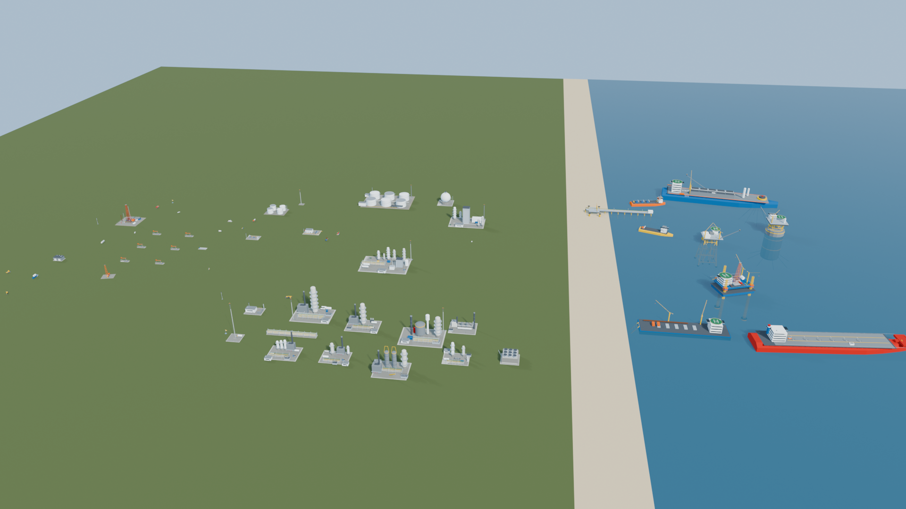
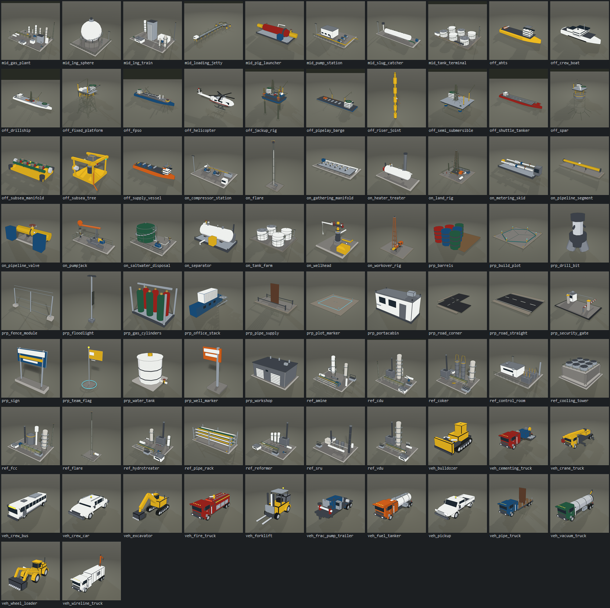
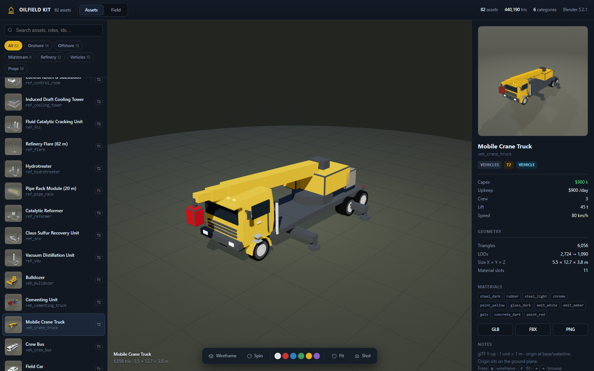

# Oil & Gas Field Development — Game Asset Kit

**82 game-ready structures, vessels, process units, vehicles and props** for a
competitive oil & gas field-development sim. Procedurally generated with
**Blender 5.2** (headless Python), exported to **glTF 2.0 (`.glb`)** and **FBX**.

> 440k triangles · 6 categories · 23 shared PBR materials · LODs + collision hulls
> · gameplay metadata in a single JSON manifest.

**Art direction: cartoon / low-poly.** Chunky faceted forms (`FACET = 0.66` globally),
fully matte surfaces (metallic 0, roughness 0.82–0.96), and ink silhouette outlines
in the preview renders. Hue families are unchanged and `paint_*` slots stay
tintable, so per-player / per-enemy colour schemes still work.





---

## Playable game prototype (Godot 4.7)

`game/` is a running Godot 4.7 GDScript prototype of the reverse-engineered
*Oil Tycoon* loop: survey → drill → roads → pipes → storage → refining → sales →
$1M lease. **Pipeline and street placement/management are the core systems**, not
decoration.

```powershell
Godot_v4.7.1-stable_mono_win64.exe --path game
```

### Controls

| Input | Action |
|---|---|
| `WASD` / arrows | pan |
| wheel | zoom |
| `Q` / `E` | rotate camera (3D mode only) |
| `C` | toggle classic isometric / 3D orbit camera |
| click the minimap | jump the camera |
| click a unit | select it (yellow ring) |
| left-click (unit selected) | move the unit there |
| right-click (unit selected) | send it to that spot and do its job |
| `Esc` | deselect the unit / cancel the tool |
| `1`–`0`, `-`, `=` | build hotkeys |
| `R` | rotate the pending structure |
| drag (pipe/road) | preview a route; release to build |
| `X` | bulldoze (drag to clear a line) |
| `Tab` | pipeline/street utilisation overlay |
| `F6` | transfer a fleet unit to the selected street |
| `F7` | demolish the selected pipe run / street network |
| `H` | field manual (network rules and keys) |
| speed buttons | `1×` / `2×` / `4×` / `8×` |
| `F5` / `F9` | save / load (`user://oilfield_save.json`) |
| `Space` | pause |

Default camera is **classic C&C-style isometric**: **orthographic**, 45° yaw /
30° pitch (2:1 dimetric), no free rotation, edge scrolling, wheel zoom. Press
**`C`** to switch to the free **3D orbit** camera (perspective, 52° pitch,
105 m, yaw/pitch orbit). This follows the classic 45°/30° isometric range rather
than a perspective 3/4 view.

### What is implemented

- **Terrain** — a coastal plain built from explicit landforms: an irregular
  domain-warped shoreline, a rolling grassland basin, a smooth mountain belt at
  the southern edge and a **river channel that holds water** (its bed drops below
  sea level). Biomes (**grass / desert / marsh-mud / rock / beach + sea**) blend
  through Terrain3D’s base+overlay control map instead of hard grid seams. The
  mesh, `HeightMapShape3D` collider and gameplay height queries share one
  heightfield. Every player gets a **flat, prepared HQ plot at start**
  (`--players=N`, default 3); other sites are levelled by paid earthworks, and the
  bulldozer’s **Flatten** action levels a 3×3 area. Runs are graded corridors;
  water and steep grades are refused.
- **Time, calendar & weather** — an in-game calendar (12 × 28-day months, four
  seasons) and a **connected weather model**: temperature, pressure, humidity,
  cloud, precipitation and fog are advanced every tick, and rain-vs-snow, wind
  strength, sunlight, production/logistics and the visual overlay are all
  derived from those drivers. Day/night sun colour and sky/ambient follow the
  calendar. The top-bar **Date** chip reads e.g.
  `Y1 Mar 14 · 08:30 · Rain 11°C −12% · ↖ NW 18 km/h`; calendar and weather are
  saved with the field. See [`docs/WEATHER.md`](docs/WEATHER.md).
- **Pipelines** — grid graph with port-based connections (per-side roles, link
  counts), rotation, port hints, drag-preview routes, in-place replacement (pipe
  over road), and **grade-based capacity** (standard / trunk / high-pressure,
  `G` to change). A run’s throughput is its **weakest cell** + pump/compressor
  **head**, minus **terrain lift** and friction over the span: each grade can
  raise a fixed static head (14 / 30 / 50 m), so climbing runs lose pressure and
  need pump or compressor stations; flat runs keep nameplate capacity. Full tanks
  throttle wells instead of destroying crude. Wells also produce **associated
  gas** — a **Gas Plant** sells it, a **Flare** burns it safely, otherwise it is
  vented at a penalty (flagged in NETWORKS). Pumps/compressors/manifolds,
  separators/heaters, metering skids (price), tanks/terminals (buffers and
  bridges), run highlight, inspector (flow, lift, pressure %, gas) and NETWORKS
  rows.
- **Streets** — roads must serve **≥2 sites**; each network has logistics capacity
  and load (over-capacity throttles production), isolated-road warning overlay,
  inspector and objective guidance. A **Truck Depot** beside a network adds a
  static +3 logistics.
- **Economy** — difficulty-based cash, loans, upkeep, market price, periodic
  **sales contracts** with a premium, victory at $1M company value (tracked in
  the VALUE chip), and a foreclosure overlay at −$250k with restart.
- **Fleet & units** — buy them in `FLEET`. Logistics units (pickup / pipe-truck)
  station on a street network and add capacity there (`F6` transfers one).
  Agent units launch from the Field Base: a **Seismic Vehicle** surveys a 7-cell
  radius, a **Site Bulldozer** prepares a 2×2 pad, a **Mobile Crane** builds
  structures on site, and a **Fuel Tanker** loops pumpjack → base → sale. Selecting
  a structure in BUILD reserves the site and dispatches the crane; nothing is
  placed instantly. While the crane works, the structure appears as a **cyan
  hologram that materialises from the ground up** (C&C-style scan), with a light
  beam, sparks and dust. Sites are **not auto-built**: select a Mobile Crane and
  **right-click the reserved site** to assign it; assign different sites to
  different cranes to build in parallel. Select a unit, **left-click to move**, **right-click to
  send it to do its job**. State/progress shows above the unit and at the site;
  a ✓ flash marks a finished job.
- **Data-driven catalogue** — 32 entries live as `res://data/catalogue.tres` plus
  `res://data/buildings/*.tres` (`BuildingDefinition` / `PortSpec` /
  `CapacitySpec`). The build menu sections, hotkeys, icons, model list and
  placement rules are generated from it. Adding a structure = one definition + a
  model + an icon (`assets/icons/<id>.png`).
- **Placement UX** — filterable build menu, route previews with cost / port
  joints / sites served, pipe snapping, port overlays, minimap jump, and an `H`
  field manual.
- **Network manager** — a live list of every pipe run and street network with
  utilisation, per-run income and upkeep; click a row to focus that run.
  Problems sort first. Runs show `dry`/`MAX`; streets show `isolated`/`busy`.
- **Field feedback** — billboard warnings (`ROAD`, `PIPE`, `TANK`, `IDLE`) over
  sites that need attention, and concrete driveways from roads to pads. Unit
  jobs show live state/progress above the unit **and** at the site; a ✓ flash
  marks completion. The bulldozer drives serpentine lanes and paints the dirt
  pad through a shader mask, so the prepared ground grows exactly where it works.
- **Persistence** — full field save/load, including the fleet and contract.

### Verification

```powershell
Godot_v4.7.1-stable_mono_win64.exe --path game -- --selftest
# 95/95 checks passed
```

Optional QA: `-- --playtest` builds a Normal ($300k) opening through the real
placement helpers and prints cash/income after 120 s. Collected evidence lives
in [`docs/VERIFICATION.md`](docs/VERIFICATION.md).

Opening plots: every run starts with `--players=N` flat, prepared HQ plots
(default **3**), e.g. `-- --players=4 --demo`. Any additional site needs a
bulldozer’s **Prepare site** action first.

Assets: Blender models follow the installed **blender-skills** workflow
(`hard-surface` + `godot-export`); see
[`docs/BLENDER_SKILLS.md`](docs/BLENDER_SKILLS.md). Sound stays muted during
boot/start and only enables after a difficulty is chosen or a save is loaded.

Weather preview: `-- --demo --weather=rain --shot` (or `snow`, `storm`, `fog`,
`heatwave`, `cloudy`, `clear`) forces a state so clouds, precipitation, wind and
lighting can be inspected immediately.

Rain/snow use the **Weather FX Free** addon (`game/addons/weather_fx`,
Godot 4.3–4.7, Compatibility): *Weather FX Free by heyheythere —
<https://heyheythere.itch.io/weather-fx-free> — CC BY 4.0*.

Screenshot modes: `-- --demo --shot`, `-- --demo --joint --shot` (pipe entering
a pumpjack port), `-- --demo --pipe-route --shot` (route preview with port
joints), `-- --demo --pipe-ports --shot` (every structure's ports while piping),
`-- --demo --warn --shot` (warning markers), `-- --demo --help --shot`
(field manual), `-- --demo --gameover --shot` (foreclosure),
`-- --demo --depot --shot` (Truck Depot inspector), `-- --demo --top --shot`,
`-- --demo --route --shot`, `-- --demo --ports --shot`,
`-- --demo --bend --shot`, `-- --demo --net --shot`, `-- --demo --overview --shot`,
`-- --demo --victory --shot`, `-- --demo --contract --shot`,
`-- --demo --units` (staged bulldozer prep, running live — add `--shot` to freeze),
`-- --prepseq` (captures the full prep sequence to `game/seq_*.png`),
`-- --markers --shot` (revealed OIL beacon + selected seismic vehicle),
`-- --buildshot --shot` (Mobile Crane building a structure).

Design docs: [`docs/REVERSE_ENGINEERING.md`](docs/REVERSE_ENGINEERING.md),
[`docs/PIPELINE.md`](docs/PIPELINE.md),
[`docs/BUILDING_CONNECTIONS.md`](docs/BUILDING_CONNECTIONS.md),
[`docs/ROAD_PIPE_SYSTEM.md`](docs/ROAD_PIPE_SYSTEM.md),
[`docs/GODOT_RESEARCH.md`](docs/GODOT_RESEARCH.md),
[`docs/VERIFICATION.md`](docs/VERIFICATION.md),
[`plans/enhancements/MASTER_TRACKER.md`](plans/enhancements/MASTER_TRACKER.md).

---

## Interactive 3D preview

A browser viewer ships with the kit: an asset browser plus an assembled-field view.



```powershell
powershell -ExecutionPolicy Bypass -File preview\serve.ps1
# opens http://localhost:8000/preview/
```

* searchable asset list with category filters and deep links (`#/asset/on_land_rig`)
* live `.glb` loading with orbit camera, wireframe, auto-spin and PNG screenshot
* **team-tint swatches** that recolour every `paint_*` material at runtime — the
  same operation your game does per player
* **Field** tab instantiates all 145 placements from
  `assets/json/demo_layout.json` on the real terrain, so the map view stays in
  sync with `blender/demo_scene.py`

Three.js r160 is vendored in `preview/vendor/`, so the page works offline. Browsers
block `fetch()` on `file://`, so use the bundled server (any static server works).


---

## What's in here

| Category | Count | What it covers |
|---|---:|---|
| **Onshore upstream** | 14 | land rig, workover rig, pumpjack, wellhead, separator, heater treater, tank farm, flare, compressor station, metering, manifold, saltwater disposal, pipeline kit |
| **Offshore & marine** | 15 | jack-up, semisubmersible, drillship, fixed platform, FPSO, spar, subsea tree, subsea manifold, riser joint, PSV, AHTS, shuttle tanker, crew boat, helicopter, pipelay barge |
| **Midstream** | 8 | pump station, slug catcher, gas plant, LNG train, LNG sphere, crude terminal, loading jetty, pig launcher |
| **Refinery** | 12 | CDU, VDU, FCC, reformer, hydrotreater, coker, amine, Claus SRU, cooling tower, flare, pipe rack, control room |
| **Vehicles** | 15 | pickup, crew bus, fuel tanker, vacuum truck, crane truck, pipe truck, cementing, wireline, frac trailer, excavator, loader, dozer, fire truck, forklift, field car |
| **Props** | 18 | fence, floodlight, cabins, sign, barrels, cylinders, roads, build plot, well marker, drill bit, pipe stack, water tank, workshop, gate, team flag, plot marker, office stack |

Full catalogue with tri counts, dimensions and gameplay stats:
**[`docs/ASSET_LIBRARY.md`](docs/ASSET_LIBRARY.md)**

Research basis (industry sources → modelled components):
**[`docs/RESEARCH.md`](docs/RESEARCH.md)**

Game design brief (match loop, reservoir model, competitive mechanics):
**[`docs/GAME_DESIGN.md`](docs/GAME_DESIGN.md)**

Pipeline, engine integration, performance and extension guide:
**[`docs/PIPELINE.md`](docs/PIPELINE.md)**

---

## Quick start

```powershell
# rebuild everything (kit + demo field + previews)
blender --background --python blender/build.py -- --render

# one category, no previews
blender --background --python blender/build.py -- --only offshore

# one asset with a thumbnail
blender --background --python blender/build.py -- --asset on_land_rig --render
```

`--only` / `--asset` builds are non-destructive: they update that asset's exports
and previews but leave the master `.blend` and `manifest.json` untouched.

### Outputs

| Path | Contents |
|---|---|
| `assets/blend/oilfield_kit.blend` | Master file, one collection per category, LODs + `_COL` hulls |
| `assets/blend/oilfield_demo_field.blend` | 63-object assembled field (onshore → refinery → offshore) |
| `assets/glb/oilfield_kit.glb` | Whole library, one node per asset |
| `assets/glb/<category>/<asset>.glb` | Individual modular props |
| `assets/fbx/<category>/<asset>.fbx` | Unreal-friendly equivalent |
| `assets/json/manifest.json` | Gameplay + geometry data, single source of truth |
| `assets/json/demo_layout.json` | Field placements consumed by the web preview |
| `assets/json/gameplay_balance.csv` | Same numbers, spreadsheet-ready |
| `assets/previews/*.png` | 640² studio thumbnails, `demo_field.png`, `contact_sheet.png` |
| `preview/` | three.js asset browser + field view (no build step) |

---

## Design decisions that matter for a game

**1 unit = 1 metre. Origin at base centre (or waterline for offshore).**
Placement is then `instantiate at hit point` — no offset arithmetic, no pivot
cleanup. Offshore assets use `placement: "waterline"` so hulls sit correctly in
the sea; subsea assets use `placement: "seabed"`.

**Forward is −Y** in Blender → +Z in glTF/Unity, +X in Unreal. Consistent across
every vehicle and structure.

**Flat PBR, no textures, 23 shared materials.** Team-vs-team play needs per-player
recolouring; swapping a base colour on `paint_*` slots is free compared to a
texture permutation. The whole kit is < 40 MB.

**Cel shading is presentation, not export.** The previews render through a
3-band toon shader (Diffuse → Shader-to-RGB → constant ramp) and Freestyle
silhouette lines, applied at render time and reverted afterwards. The `.glb` /
`.fbx` keep standard PBR materials so any engine can apply its own toon ramp —
the web viewer does exactly that with `MeshToonMaterial`.

**Everything is data.** Each asset's capex, build time, capacity, crew, power and
tier live in `manifest.json` next to its tri count and dimensions. The build menu,
economy and placement validator can all read the same file.

**LODs and collision are generated, not modelled.** `*_LOD1` (~45%), `*_LOD2`
(~18%), `*_COL` box hulls, all named predictably.

---

## Conventions

| Rule | Value |
|---|---|
| Units | 1 Blender unit = 1 m |
| Origin | base centre, `z = 0` on ground / waterline |
| Forward | −Y (Blender) |
| Up | +Z (Blender) |
| Shading | flat/faceted stylised industrial |
| Materials | Principled PBR, untextured, team-tintable |
| Snap tags | `pipe`, `road`, `rack`, `plot`, `fence` |

---

## Extending

Add a builder function and one registry entry; the mesh, both exports, the
manifest and the docs table all follow automatically.

```python
# blender/kit/onshore.py
def my_unit(a):
    P.skid(a, 6, 3, 0.3)
    a.box((2, 1.8, 1.6), (0, 0, 1.3), "paint_blue", bevel=0.05)
    P.pipe_run(a, [(-2, 0, 1.8), (2, 0, 1.8)], 0.18, "pipe_yellow", supports=True)

REGISTRY = [..., dict(aid="on_my_unit", name="My Unit", build=my_unit,
                      gameplay=dict(role="processing", tier=2, cost_usd=1_200_000))]
```

See `docs/PIPELINE.md` for the full part vocabulary (derricks, tanks, columns,
valves, cranes, helidecks, vehicle chassis…).

---

## Notes

* Built and verified against **Blender 5.2.1 LTS** on Windows. The generator uses
  only stable `bmesh` / `bpy.data` APIs — it should run unchanged on 4.2+.
* Every object in the demo field is an *instance* of a kit mesh, so editing a
  builder changes both the catalogue and the demo layout.
* Previews are EEVEE renders with a three-sun studio rig; they are documentation,
  not game assets.
* `blender/gen_docs.py` regenerates `docs/ASSET_LIBRARY.md` and the balance CSV
  from the manifest; `tools/contact_sheet.ps1` rebuilds the contact sheet.
